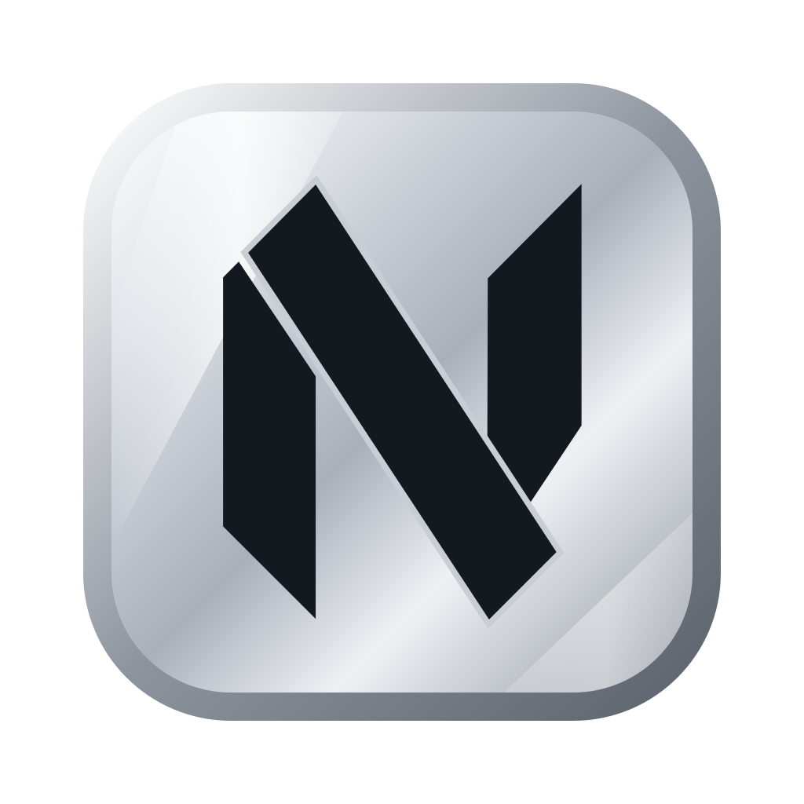

# AgVim



A free, open source Neovim workspace for Mac that makes agentic coding easy. Big IDEs were built for people typing every line. Now that agents can do so much of that, what's left is reading code, reviewing changes and keeping your agents organised, and that only takes something simple.

Each project gets a tab, with full-screen tabs inside for Neovim, lazygit, shells and coding agents, one click apart. It works with Claude, Codex, Copilot, Gemini, DeepSeek, OpenCode and more; you install the ones you use. Close a project and everything in it stops, freeing the memory. Open it again and your tabs come back, and agents that can resume continue their conversations, each Claude tab its own.

Several agents can work on one project at once: a worktree gives one a branch in a folder of its own, with its own tabs, and **Merge** brings the work back. A dot on every tab shows whether its agent is working, waiting for you or done.

As you type, AI suggestions appear, free through Copilot's free tier with a GitHub account, or from your own Claude, OpenAI, Gemini, DeepSeek or other API key.

**Website:** https://robertsolves.github.io/agvim/

## Install

```sh
curl -fsSL https://raw.githubusercontent.com/robertsolves/agvim/main/install.sh | bash
```

Or download [`AgVim.dmg`](https://github.com/robertsolves/agvim/releases/latest/download/AgVim.dmg), drag it to Applications and open it. macOS may ask you to allow it in System Settings → Privacy & Security → **Open Anyway**.

Either way it sets up what's missing once (Homebrew, kitty, git, Neovim, tmux, lazygit and the other basics), then opens in kitty. Tools you already have are kept and updated to their latest versions. Only the languages you code in are yours to install.

## Use

Click the AgVim icon, or type `agvim` in any terminal. It asks what you want to do; `agvim help` lists every command.

The [guide](docs/GUIDE.md) covers projects, tabs, agents, keys and commands. To remove it all: `agvim uninstall`.

## Contribute

See [CONTRIBUTING.md](CONTRIBUTING.md). AgVim opens itself as its first tab, so you can change it from inside it.

## License

[MIT](LICENSE). AgVim builds on many open source projects, [listed on the website](https://robertsolves.github.io/agvim/). The Neovim config starts from NvChad's starter ([its license](nvim/LICENSE)). The icon uses the [Neovim logo](https://neovim.io) by Jason Long ([CC BY 3.0](https://creativecommons.org/licenses/by/3.0/)), recoloured, on silver. AgVim isn't affiliated with Neovim.
